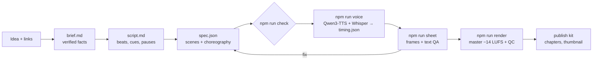

# Motion Graphics Engine

A programmatic motion design studio for **system design explainer videos**, operated by Claude.
You bring an idea and a few links; Claude researches it, writes the script, choreographs the motion
graphics as a JSON spec, voices it, reviews its own frames and renders a YouTube-ready file with a
publish kit. Everything runs locally and free: Remotion for the picture, Qwen3-TTS for the voice,
procedural house music and sound. 16:9 first; 9:16 follows the same design system.


<details><summary>Light theme</summary>


</details>

## Quick start (macOS)
Needs Node 20+, [Homebrew](https://brew.sh) and [Claude Code](https://docs.claude.com/en/docs/claude-code/setup).
```bash
git clone https://github.com/sainp7/motion-graphics-engine.git && cd motion-graphics-engine
npm run setup        # tools, packages, Python 3.12, house audio, Claude Code plugin; safe to re-run
claude               # then: /studio:new-video Why does a cache stampede take down a database? https://…
```
`npm run setup -- --models` also pre-downloads the voice models (~5.5 GB); otherwise they download
on the first `npm run voice`. Remotion fetches its headless Chrome on the first render; no ffmpeg
install is needed.

<details><summary>What setup does, step by step</summary>

| step | skipped when |
|---|---|
| `brew install uv sox espeak-ng` | each tool is already on `PATH` |
| `npm install` (also generates `src/registry.generated.ts`) | `node_modules` is newer than the lockfile |
| `uv python install 3.12` (the voice pipeline) | Python 3.12 is available to uv |
| `npm run house-audio`: sound kit and music stems into `public/` | they exist |
| copy `docs/claude-settings.json` → `.claude/settings.json` (pre-approves the studio's commands) | the file exists |
| `claude plugin marketplace add ./` and `claude plugin install studio@motion-graphics-engine` | Claude Code is not installed (it tells you) |
</details>

## Making a video
In Claude Code, in this folder:
```
/studio:new-video Why does a cache stampede take down a database? https://…
```
Claude walks the workflow and stops twice for you: to pick the angle and hook, and to approve the
script. Everything else it runs and checks itself:

| step | command | output |
|---|---|---|
| scaffold | `npm run new -- 002-rate-limiting "Rate limiting"` | `videos/<id>/` |
| lint + timeline | `npm run check -- <id>` | errors, warnings, segment table, music energy |
| look | `npm run sheet -- <id>` | `out/<id>/sheet-*.jpg`, `sheet.md` with QA |
| voice | `npm run voice -- <id>` (`--engine kokoro` for a fast draft) | narration + `timing.json` |
| preview | `npm run studio` | Remotion Studio |
| render | `npm run render -- <id>` (`--theme light`, `--draft`) | `out/<id>/<id>-dark.mp4`, `qc.md` |
| publish | `npm run publish-kit -- <id>` | `videos/<id>/publish.md`, `out/<id>/thumbnail.png` |

`videos/001-cache-stampede` is a complete reference episode (about 3:50, every scene type).
`npm run sheet -- gallery` renders the design-system gallery.

## Themes
Every video renders in **dark** (default) or **light**, a clean paper-white theme with the same
colour meanings. Pick one per video in its spec:
```json
{ "id": "002-rate-limiting", "theme": "light", … }
```
or override per command without touching the spec:
```bash
npm run render -- 001-cache-stampede --theme light     # out/001-cache-stampede/001-cache-stampede-light.mp4
npm run sheet  -- 001-cache-stampede --theme light
```
In `npm run studio`, every video also appears in the other theme under **other-theme** (`<id>-light`).

## Voice
The narrator is **Qwen3-TTS** (1.7B CustomVoice, speaker "Aiden"), running on the Mac's GPU. Every
beat has a `pace` (slow, normal, brisk, rush) and a `style` (calm, serious, urgent, excited, warm,
neutral), set by the segment's choreography unless the script overrides them; Qwen turns them into
a delivery instruction, so the hook sounds urgent and the fix sounds excited. Whisper times every
word so the visuals stay synced. Needs ~8 GB of free RAM.

| engine | use | cost |
|---|---|---|
| `qwen3` (default) | final narration | free, local |
| `kokoro` | fast drafts (no style control): `--engine kokoro` | free, local |
| `say` | instant macOS draft | free |
| `elevenlabs` | optional; `ELEVENLABS_API_KEY`, and a paid plan for monetised videos | paid |

Tuning via environment: `QWEN_TTS_SPEAKER`, `QWEN_TTS_SEED` (another take), `QWEN_TTS_TEMPERATURE`,
`QWEN_TTS_DEVICE`, `WHISPER_MODEL`. Words the narrator mispronounces go in `library/pronunciation.json`.

## Music and sound
The default track is **Transit Drive** (`audio/house_drive.py`): a 112.5 BPM house groove in A minor
with a four-on-the-floor kick, a pumping 8th-note bass, claps and hats. It is four looping stems, and
each segment's choreography sets the energy: the body grooves, failures and insights cut to silence,
the groove slams back on the beat, and the fixes get the full band. `house-night-transit` is a calmer
alternative (`"music": { "track": "house-night-transit" }`). Sound effects come from a small house kit
(`audio/house_sfx.py`), placed automatically from scene events and thinned so none becomes a metronome.
All of it is generated, CC0 and safe to monetise; `npm run house-audio` regenerates it.

## Why it looks consistent
- **One renderer, many specs.** Each video is `videos/<id>/spec.json`. The renderer (Remotion + React)
  plays any valid spec, so video #200 uses the same components, tokens and timing as video #2.
- **The system is a transit map.** Components are stations, requests ride coloured lines and leave
  them painted, chapters are stations on a route, transitions are a line wiping across. Colour always
  means something; both themes share every meaning.
- **Choreography per segment, theme per video.** Each segment declares its intent (`cold-open`,
  `build`, `flow`, `failure`, `solution`, `insight`, …). The intent sets motion, stage, word budget,
  voice pace and delivery, music energy and sound effects. A failure goes red and silent; the fix
  that follows goes green with the full groove.
- **Audio-first.** Narration timing drives the picture: visuals are keyed to cue words, and the
  deliberate `[pause]`s in the script become pauses on screen.
- **Signage, not captions.** On-screen text names the idea in a few words while the voice explains
  it; the linter flags captions. Chapters ask a question, each fix is named on screen.
- **Review is built in.** A linter for editorial rules, contact sheets with an automated text probe
  (clipped, unsafe, overlapping), a fresh-eyes reviewer agent and a delivery QC report
  (−14 LUFS, true peak, format).

## How it fits together


| path | what |
|---|---|
| `plugin/` | the Claude Code plugin `studio`: skills, agents, guardrail hooks |
| `src/spec/` | spec schema, markup parsers, timing, compiler |
| `src/choreo/presets.ts` | choreography presets (motion, voice, music, sound per intent) |
| `src/design/` | tokens (colour, type, layout, motion), themes, fonts |
| `src/scenes/` | statement, stat, diagram, sequence, compare, list, chapter, code, outro |
| `src/audio/`, `audio/` | the mix in Remotion; Python TTS and house sound generators |
| `scripts/` | the CLI behind `npm run …`, including `setup.sh` |
| `library/` | music and sfx manifests (with licences), pronunciation, reference notes, backlog |
| `videos/` | one folder per video: brief, script, spec, publish kit |
| `docs/adr/` | design decisions |

Generated files are not committed: `out/`, `public/videos/`, `public/sfx/`, `public/music/` and
`src/registry.generated.ts` all come back from `npm run setup`, `npm run voice` and `npm run render`.

## Using it as a template
On GitHub, mark the repo as a **Template repository** (Settings → General), then "Use this
template" for a new channel. Change the handle (`@sainp7` in the outro of `videos/*/spec.json` and in
`scripts/new.ts`), the colours and type in `src/design/tokens.ts`, and keep or delete the reference
episode.

## Extending
When a video needs something the spec cannot express, add it once, generally: schema → compiler →
component → lint → gallery in both themes → docs. The `extend-studio` skill walks Claude through it.

## Licences
Code MIT. House sounds and music CC0 (generated by this repo). Third-party components and models in
[NOTICE.md](NOTICE.md). Remotion is free for individuals and small companies; check its licence if you
use this template at a larger company. Check each voice model's licence on its model page before
publishing commercially.
