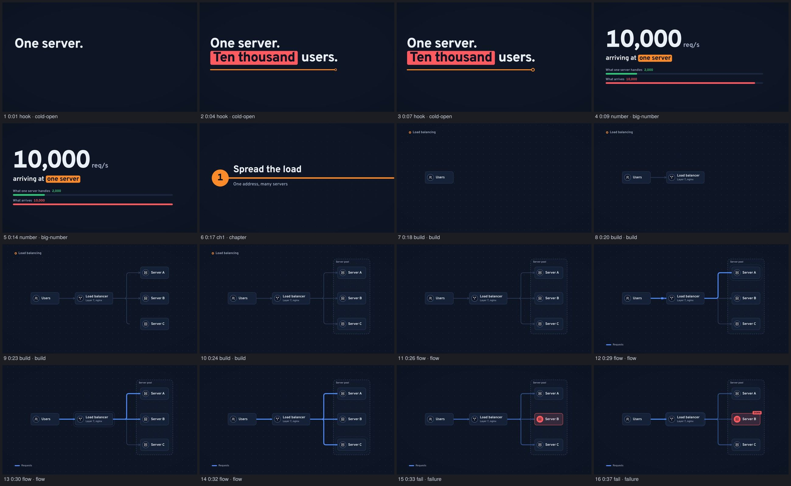
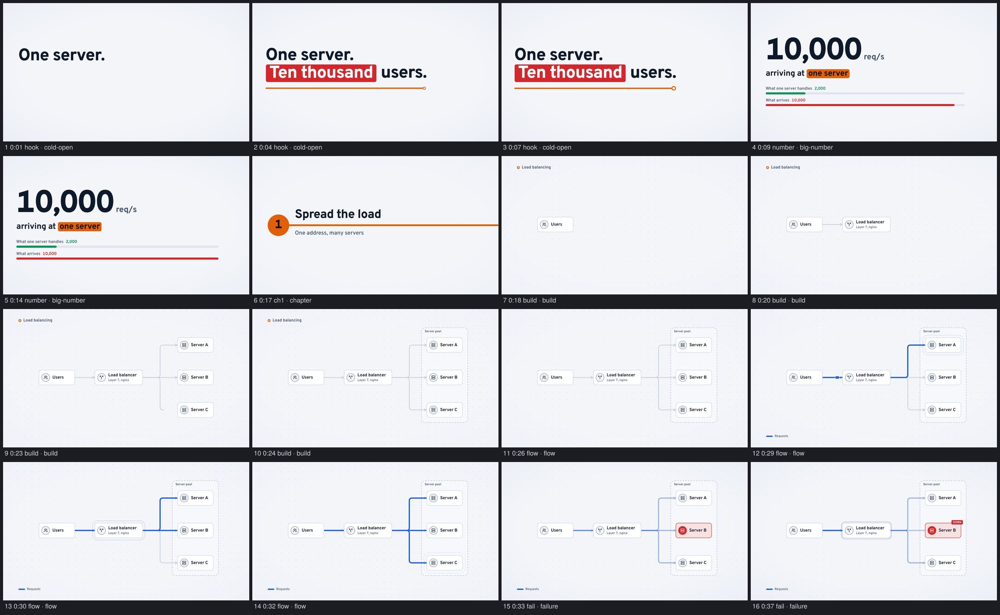
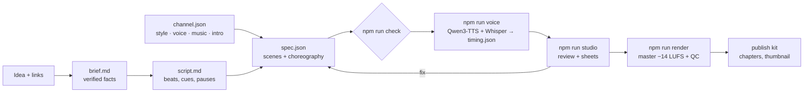

# Motion Graphics Engine

A programmatic motion design studio, operated by Claude, for running several explainer channels
from one repo. You bring an idea and a few links; Claude researches it, writes the script,
choreographs the motion graphics as a JSON spec, voices it, reviews its own frames and renders a
YouTube-ready file with a publish kit. Each **channel** fixes a **motion style**, a narrator, a music
bed and a channel intro; the engine stays open. Everything runs locally and free: Remotion for the
picture, Qwen3-TTS for the voice, procedural house music and sound. 16:9 first; 9:16 follows the
same design system.



<details><summary>Light theme</summary>


</details>

## Quick start (macOS)
Needs Node 20+, [Homebrew](https://brew.sh) and [Claude Code](https://docs.claude.com/en/docs/claude-code/setup).
```bash
git clone https://github.com/sainp7/motion-graphics-engine.git && cd motion-graphics-engine
npm run setup        # tools, packages, Python 3.12, house audio, Claude Code plugin; safe to re-run
npm run studio       # the review studio in your browser
claude               # then: /studio:new-video Why does a cache stampede take down a database? https://…
```
`npm run setup -- --models` also pre-downloads the voice models (~5.5 GB); otherwise they download
on the first `npm run voice`. Remotion fetches its headless Chrome on the first render; no ffmpeg
install is needed.

<details><summary>What setup does, step by step</summary>

| step | skipped when |
|---|---|
| `brew install uv sox espeak-ng` | each tool is already on `PATH` |
| `npm install` (also generates the registries in `src/*.generated.ts`) | `node_modules` is newer than the lockfile |
| `uv python install 3.12` (the voice pipeline) | Python 3.12 is available to uv |
| `npm run house-audio`: sound kit and music stems into `public/` | they exist |
| copy `docs/claude-settings.json` → `.claude/settings.json` (pre-approves the studio's commands) | the file exists |
| `claude plugin marketplace add ./` and `claude plugin install studio@motion-graphics-engine` | Claude Code is not installed (it tells you) |
</details>

## Making a video
In Claude Code, in this folder:
```
/studio:new-video Why does a cache stampede take down a database? https://…
```
Claude walks the workflow and stops twice for you: to pick the angle and hook, and to approve the
script. Everything else it runs and checks itself:

| step | command | output |
|---|---|---|
| scaffold | `npm run new -- 004-rate-limiting "Rate limiting" [--channel essays]` | `videos/<id>/` |
| lint + timeline | `npm run check -- <id>` | errors, warnings, segment table, music energy |
| look | `npm run sheet -- <id>` (`--style`, `--theme`, `--at m:ss`) | `out/<id>/sheet-*.jpg`, `sheet.md` with QA |
| voice | `npm run voice -- <id>` (`--engine kokoro` for a fast draft) | narration + `timing.json` |
| review | `npm run studio` | the review studio |
| render | `npm run render -- <id>` (`--theme light`, `--style editorial`, `--draft`) | `out/<id>/<id>-dark.mp4`, `qc.md` |
| publish | `npm run publish-kit -- <id>` | `videos/<id>/publish.md`, `out/<id>/thumbnail.png` |

Reference episodes:

| video | channel · style | shows |
|---|---|---|
| `001-cache-stampede` | systems · transit | every library scene type, the transit intro (3:55) |
| `002-consistent-hashing` | systems · transit | React custom scenes: the modulo scatter, the hash ring (3:15) |
| `003-tail-latency` | essays · editorial | the editorial style and intro, a pure-JS GSAP scene (1:19) |

## The studio
`npm run studio` opens the review studio (a Vite app around Remotion's Player):
- pick any video (grouped by channel); preview it in **any style** and either theme without
  touching the spec
- a segment timeline (bar height = music energy, chapters above), click to jump
- the script under the player, the current word lit, click a word to jump to it
- the current segment's choreography, its cues (click to jump) and the linter's findings
- buttons for Voice, Sheet, Draft render and Render, with the job output beside the player
- keys: `Space` play · `←`/`→` frame (`Shift` 1 s) · `J`/`L` ±5 s · `[`/`]` segment · `T` theme · `M` music
- edit `spec.json` and the preview reloads; new videos, scenes, channels and styles appear without a restart

Remotion's own Studio is still there as `npm run remotion-studio`.

## Channels and styles
One repo, many channels. A **channel** (`channels/<id>/channel.json`) fixes how its videos look and
sound; a video names its channel (or uses `studio.json`'s `defaultChannel`) and inherits everything:
```json
{ "id": "systems", "name": "Systems in Motion", "tagline": "System design, explained in minutes",
  "handle": "@sainp7", "style": "transit", "theme": "dark",
  "voice": { "engine": "qwen3", "voice": "Aiden" }, "music": { "track": "transit-drive", "volume": 0.22 },
  "intro": { "enabled": true, "seconds": 3.5, "line": "orange", "formats": ["landscape"] },
  "outro": { "cta": "Follow for more system design" } }
```
A **style** (`src/styles/<id>/`) is a motion design family: palettes, fonts, type scale, curves,
plate look, its own versions of any scenes, a background, transitions and the intro. Scenes it does
not override come from the shared library, restyled by its tokens, so every spec renders in every
style.

| style | look | made for |
|---|---|---|
| `transit` | the system is a transit map: stations, painted lines, signage type, line-wipe | system design, architecture |
| `editorial` | kinetic serif type on paper, highlighter plates, numbered sections, page-wipe | essays, story-led explainers |

```bash
npm run new-channel -- essays "Field Notes" --style editorial --handle @you   # a new channel or account
npm run new-style -- blueprint "Blueprint" --from transit                     # a new style to design
npm run sheet -- gallery --style blueprint                                    # every scene type in it
```
The library is meant to grow to 10–20 styles; each channel picks one. The `styles-and-channels`
skill walks Claude through building one.

### The channel intro
Long-form YouTube videos open with the hook, then a short channel intro, then the video. The
compiler inserts it after the first segment from the channel's `intro` settings, drawn by the
style's `Intro` (transit: a line with stations and the name rising out of it; editorial: a masthead),
with the music dropping in at full energy. Shorts and Reels skip it (`formats`); a video can skip it
(`"intro": false`) or move it (`"intro": { "after": "myth" }`).

## Themes
Every style has a **dark** and a **light** theme with the same colour meanings. The channel sets
the default; a video can set `"theme": "light"`, or override per command:
```bash
npm run render -- 001-cache-stampede --theme light     # out/001-cache-stampede/001-cache-stampede-light.mp4
```
In the studio, the Dark/Light toggle (or `T`) switches the preview.

## Voice
The narrator is **Qwen3-TTS** (1.7B CustomVoice, speaker "Aiden"), running on the Mac's GPU. Every
beat has a `pace` (slow, normal, brisk, rush) and a `style` (calm, serious, urgent, excited, warm,
neutral), set by the segment's choreography unless the script overrides them; Qwen turns them into
a delivery instruction, so the hook sounds urgent and the fix sounds excited. Whisper times every
word so the visuals stay synced. Needs ~8 GB of free RAM.

| engine | use | cost |
|---|---|---|
| `qwen3` (default) | final narration | free, local |
| `kokoro` | fast drafts (no style control): `--engine kokoro` | free, local |
| `say` | instant macOS draft | free |
| `elevenlabs` | optional; `ELEVENLABS_API_KEY`, and a paid plan for monetised videos | paid |

Tuning via environment: `QWEN_TTS_SPEAKER`, `QWEN_TTS_SEED` (another take), `QWEN_TTS_TEMPERATURE`,
`QWEN_TTS_DEVICE`, `WHISPER_MODEL`. Words the narrator mispronounces go in `library/pronunciation.json`.

### Your own voice
Qwen3-TTS can clone a voice from a short recording, so a channel can sound like you:
```bash
npm run voice-ref -- paras     # creates library/voice/paras/ with a recording guide and a line per style
# record calm.wav, urgent.wav, excited.wav, serious.wav there (8–20 s each)
npm run voice-ref -- paras     # checks length, level, noise, clipping, and that the words match
```
Then set `"voice": { "engine": "qwen3", "voice": "clone:paras" }` in the channel (or one video). The
clone model takes no style instruction, so delivery comes from your recordings: each beat uses the
take in its style, with fallbacks when one is missing. The recordings are git-ignored, because anyone
with them can clone the voice; `voice.json` and the transcripts are safe to commit.

## Custom scenes
The scene library (statement, stat, diagram, sequence, compare, list, chapter, code, outro) keeps
every video consistent and quick to make. For the one to three moments per video that need more, a
video ships its own scenes in `videos/<id>/scenes/`, in either of two forms:

| form | file | best for |
|---|---|---|
| React | `HashRing.tsx` | layouts and state that read well as components; the kit's primitives |
| pure JS/TS, seekable | `FanOut.js` | GSAP timelines, canvas and WebGL, three.js, particle systems |

```json
{ "type": "custom", "component": "FanOut", "cues": { "ten": "c-ten", "hundred": "c-hundred" },
  "signage": ["1 request", "63%"] }
```
Both are free in what they draw and bound to the studio in everything else: theme colours, type
scale and curves from the style, moments as cues on narration words, voice, music and transitions
from the choreography, and the same guardrails and text QA. A script scene follows HyperFrames'
frame-adapter contract (`setup(ctx)` once, then `seek(t)` per frame), so a paused GSAP timeline
drops straight in. A custom scene that proves itself twice is promoted into the library.

## Music and sound
The default track is **Transit Drive** (`audio/house_drive.py`): a 112.5 BPM house groove in A minor
with a four-on-the-floor kick, a pumping 8th-note bass, claps and hats. It is four looping stems, and
each segment's choreography sets the energy: the body grooves, failures and insights cut to silence,
the groove slams back on the beat, the intro and the fixes get the full band. `house-night-transit`
is a calmer alternative. Sound effects come from a small house kit (`audio/house_sfx.py`), placed
automatically from scene events and thinned so none becomes a metronome. All of it is generated, CC0
and safe to monetise; `npm run house-audio` regenerates it.

## Why videos stay consistent
- **One renderer, many specs.** Each video is `videos/<id>/spec.json`. The renderer plays any valid
  spec, so video #200 uses the same components, tokens and timing as video #2.
- **A channel is a contract.** Style, theme, voice, music, intro and sign-off come from the channel,
  so a channel's videos are one family even when they are made months apart.
- **Choreography per segment.** Each segment declares its intent (`cold-open`, `build`, `flow`,
  `failure`, `solution`, `insight`, …), which sets motion, stage, word budget, voice pace and
  delivery, music energy and sound. A failure goes red and silent; the fix goes green with the groove.
- **Audio-first.** Narration timing drives the picture: visuals are keyed to cue words, and the
  deliberate `[pause]`s in the script become pauses on screen.
- **Signage, not captions.** On-screen text names the idea in a few words while the voice explains
  it; the linter flags captions. Chapters ask a question, each fix is named on screen.
- **Review is built in.** A linter for editorial rules, contact sheets with an automated text probe
  (clipped, unsafe, overlapping), a fresh-eyes reviewer agent and a delivery QC report
  (−14 LUFS, true peak, format).

## How it fits together


| path | what |
|---|---|
| `plugin/` | the Claude Code plugin `studio`: skills, agents, guardrail hooks |
| `channels/` | one folder per channel or account; `studio.json` names the default |
| `src/styles/` | the motion style library (`transit`, `editorial`, …) |
| `src/spec/` | spec and channel schemas, markup parsers, timing, compiler |
| `src/choreo/presets.ts` | choreography presets (motion, voice, music, sound per intent) |
| `src/design/` | shared tokens and the theme/style plumbing |
| `src/custom/` | the APIs custom scenes build on (`kit.ts` for React, `script-kit.ts` for JS) |
| `src/scenes/` | the shared scene library |
| `src/audio/`, `audio/` | the mix in Remotion; Python TTS and house sound generators |
| `studio/` | the review studio |
| `scripts/` | the CLI behind `npm run …`, including `setup.sh` |
| `library/` | music and sfx manifests (with licences), pronunciation, cloned voices, references, backlog |
| `videos/` | one folder per video: brief, script, spec, publish kit, optional `scenes/` |
| `docs/adr/` | design decisions |

Generated files are not committed: `out/`, `public/videos/`, `public/sfx/`, `public/music/` and
`src/*.generated.ts` all come back from `npm run setup`, `npm run voice` and `npm run render`.

## Using it as a template
On GitHub, mark the repo as a **Template repository** (Settings → General), then "Use this
template". Make your channel with `npm run new-channel`, set it as `defaultChannel` in
`studio.json`, and keep or delete the reference episodes and sample channel.

## Extending
When a video needs something the spec cannot express, add it once, generally: schema → compiler →
component → lint → gallery in every style → docs. The `extend-studio` skill walks Claude through
it; `styles-and-channels` covers new styles and channels; `custom-scenes` covers one-off moments.

## Licences
Code MIT. House sounds and music CC0 (generated by this repo). Third-party components, fonts and
models in [NOTICE.md](NOTICE.md). Remotion is free for individuals and small companies; check its
licence if you use this template at a larger company. Check each voice model's licence on its model
page before publishing commercially.
